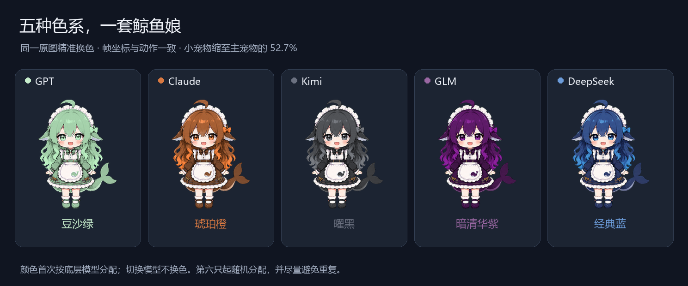

# DSH Pets · dsh-pets-multiworkers

**One tank, every conversation — see what your AI is doing at a glance.**

Most pet plugins give you one mascot. This one puts **every active top-level conversation in the same tank at once**, so a whole work queue is visible without switching sessions:

| What you need to know | How the tank shows it |
| --- | --- |
| Which conversation is working | Each pet plays its own real phase — thinking, tool running, waiting for you, done, failed — with that session's own status bubble. Background pets sit at 52.7% size so the focused one reads first. |
| Which model or vendor is busy | Stable per-session palettes for DeepSeek, GPT, Claude, GLM, Kimi and more, plus extra hues that keep same-vendor sessions apart. |
| How fast it is going | Left/right running speed follows that session's footer tok/s (`FPS = max(1, k × tok/s + b)`), so a faster model visibly runs faster. |
| A conversation to keep watching | Open the row's `...` menu (or right-click it) → **专属宠物保持** (keep pet shown): the conversation's own pet stops being recycled after its result is viewed and you move on. Focus gives it the main size; the rest stay secondary. |
| What a subagent is doing | Opening a subagent hands the main pet that session's own generation state and footer rate; returning restores the parent. Subagent pets keep the ordinary show/hide rules. |
| Desktop presence | Optional native overlay windows without patching app.asar, a status-only bubble mode with no artwork, and a hover or right-click care panel. |

**Multi-pet without multi-chore.** Feeding, affinity, treats, naming, dragging and size controls are shared across the whole tank. Pick the whale-girl, MIKU or business blue whale; the business whale's artwork, base and hit area carry an extra 0.75 scale.

**New in 1.5.0:** the keep row, the persisted kept list, and settled idle pets for kept conversations that are cold (for example after a Host restart). Deleting a conversation clears its flag, so no ghost pet remains. The same release renames the package from `dsh-pet-copilot`; the pet row id, `pet.json`, settings namespace and care data are unchanged. See the [release notes](docs/release-notes/v1.5.0.md).

**The npm package is `dsh-pets-multiworkers`; the repository is `ltmroberthk915/dsh-pet`.** Get the matching precompiled archive from [Releases](https://github.com/ltmroberthk915/dsh-pet/releases). `dsh-session-pet.tgz` remains an identical compatibility filename. Catalog copy for **dsh-market** (awesome-dsh-plugin registry) and **dsh-open-market** (dsh-plugin-index) is kept in both GitHub registries with this same description.

This independent fork of [zhu1090093659/dsh-pet](https://github.com/zhu1090093659/dsh-pet) is maintained by ltmroberthk915 under Apache-2.0, with artwork attribution preserved. [中文说明](README.zh.md)



Running animation can instead use fixed FPS or original timings; users may enable a running cap and set other-action FPS separately. Disabling that second control retains original action timings. Completed companions wait until viewed; hover expansion is off by default, with a settings switch and the manual right-click panel still available. The [1.4.0 release](https://github.com/ltmroberthk915/dsh-pet/releases/tag/v1.4.0) added the draggable status-only bubble and measured alpha click envelopes; 1.4.2 reduced native pet startup I/O. Those notes describe the package under its previous name.

## Installation

In **Settings → Plugins → Add plugin**, enter **`dsh-pets-multiworkers`**. The registry listing is new; until the catalog index picks it up, install the Release archive or a local archive as described below. Enter the package name instead of the GitHub repository URL to use the precompiled package and avoid downloading the source archive.

Use the Desktop installation's exact CLI, rather than an older global dsh:

```powershell
$dsh = "$env:LOCALAPPDATA/Programs/DeepSeek Harness/resources/runtime/cli/bin/dsh.cmd"
& $dsh plugin --profile desktop why dsh-pets-multiworkers
```

For a custom installation, point $dsh to its resources/runtime/cli/bin/dsh.cmd. Do not add resources/runtime/bin to the global PATH. Download `dsh-pets-multiworkers-1.5.0.tgz`, verify SHA256SUMS.txt, then install a named local target, replacing the example path:

```powershell
& $dsh plugin --profile desktop add 'dsh-pets-multiworkers@file:C:/Downloads/dsh-pets-multiworkers-1.5.0.tgz'
```

Users need not pack the repository or install pnpm. Use web for a web host. First-time bundle additions can hot-load. Fully quit and reopen DSH for a loaded-version replacement, restart-required receipt or stale client UI; successful hot-loading does not itself need a restart. Native companions use the existing Desktop runtime without patching app.asar or installing another Node/Electron/PowerShell runtime.

## Rename migration

Version 1.5.0 renames `dsh-pet-copilot` to `dsh-pets-multiworkers`. Back up DSH, remove the old `dsh-pet-copilot` bundle (and any older `@ltmroberthk915/dsh-pet` / `@linxin666/dsh-pet` row) from the selected profile, then install the new name. Run the launcher from the Release's `dsh-pet-profile-migration-1.5.0.zip` or the installed scripts directory. DSH matches overrides by both row ID and package name, so keeping only `id: pet` does not preserve settings saved under the old name.

The tool validates real Host composition, backs up the patch, and changes only matching name scalars in one profile. Config, disabled state, comments and other plugins survive. The shared home patch is never rewritten. Conflicts with newer settings, aliases or concurrent edits stop the operation; a profile that already carries more than one inert legacy pet row is stopped for review instead of producing duplicate matching rows. Care data remains in the original pet.json. See the [migration guide](docs/fresh-install-v1.5.0.md).

## Release age and registry source

Default non-strict pnpm 11.7.0 can install a fresh release and automatically add a version-specific exclusion. Explicit minimumReleaseAge: 1440 without disabling strict behavior rejects immature releases. With minimumReleaseAgeStrict: true, exact pins and npm tarball URLs cannot bypass the threshold. Longer custom waiting periods remain effective. Default-policy success does not prove strict-policy success; not every user must wait 24 hours.

For updates, publish to next, preserve the existing stable latest, wait at least 24 hours, then require a strict registry-install receipt without exclusions before promoting latest. First publication has a separate initialization path: npm automatically creates latest and rejects removing it; staged publishing initially points it at an empty 0.0.0-stage package. After official-registry fresh installation and identical-version reinstallation pass, initialize latest to the first real release while retaining next. The initialization command rejects packages with any earlier real published version. Consumer global policies are never modified.

Identical-version reinstalls have a separate lockfile check. With real pnpm 11.7.0 and an isolated registry, upgrading 1.3.2 to 1.3.3 succeeds, but immediately adding 1.3.3 again fails with `ERR_PNPM_MINIMUM_RELEASE_AGE_VIOLATION` despite both version exclusions. The installed version and bundle selection survive. Do not delete user lockfiles or disable global policies to mask the failure; verify fresh installs, upgrades and reinstalls separately.

The bundled pnpm 11.7.0 evaluator uses the first matching package rule. Two separate exclusions for the same package can therefore ignore the later version. If both exact versions have already been approved, consolidate those existing entries into one exact-version union, for example `dsh-pet-copilot@1.3.2 || 1.3.3` for the previous package (use the new package name for new versions), preserving unrelated rules. The equivalent CU reproduction passed after this change without adding an allowed version. Pet 1.3.3 fresh installation and immediate reinstallation with a single exclusion both pass; this does not establish a pass for every earlier upgrade history.

Maintainers run `node scripts/release-channel.mjs check 1.5.0`. Checks accept DSH_PET_REGISTRY, such as https://registry.npmmirror.com, and report registry and authoritative. Network errors identify the queried source instead of claiming the package is unpublished. Promotion ignores mirrors and rechecks identity, time and tags against official npm.

## Development

Use pnpm 11.7.0: `pnpm install --frozen-lockfile --ignore-scripts`, `pnpm typecheck`, `pnpm test`, `pnpm build`, then `node scripts/build-desktop-manifest.mjs` and `node scripts/package-companions.mjs`.

Archives omit development source, tests and consumer lifecycle scripts, exclude retired MIKU interpolation frames, and are reopened to validate all served assets and JavaScript entries. Migration tests use actual loadProfileDirectory and composeEntries; release-age tests isolate profiles, caches and stores and use the official manager and market bridge. Fixture-registry, public-registry and catalog results are distinct. See the [Windows guide](docs/install-desktop-windows.md).
