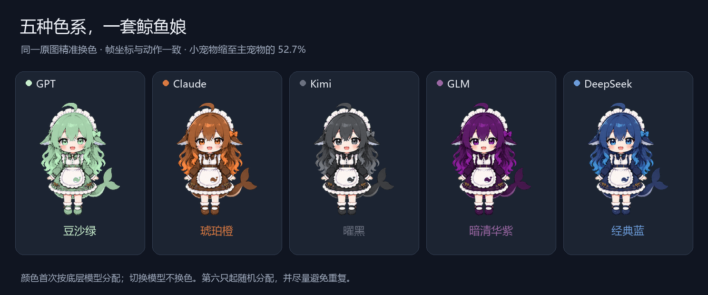

# 多形象会话桌宠 · dsh-pets-multiworkers

**一池多宠，工作状态一眼可见。**

多数桌宠插件只能守着一只形象。这里把**所有活跃顶层会话同时放进一个鱼池**，不用来回切会话就能看到整条工作队列：

| 你想知道 | 鱼池怎么告诉你 |
| --- | --- |
| 哪个会话在干活 | 每只宠物按真实阶段做动作：思考、执行工具、等待你、完成、失败，并显示该会话自己的状态气泡；后台宠物以 52.7% 大小排在旁边，焦点那只最清楚。 |
| 哪个模型/供应商在忙 | 每个会话按模型分配稳定配色（DS/GPT/Claude/GLM/Kimi 等），同供应商的并发会话再用额外色相区分。 |
| 它跑得多快 | 左右跑动速度跟随该会话底栏 tok/s（`FPS = max(1, k × tok/s + b)`），模型越快，宠物跑得越快。 |
| 哪个对话要一直盯着 | 会话行 `...` 菜单（或右键）→「专属宠物保持」：结果查看后切走也不回收；聚焦它时主大小，其余保持次大小。 |
| 子代理在做什么 | 打开子会话时主宠物跟随子代理自己的生成状态与底栏 tok/s，切回父会话恢复；子代理宠物按原逻辑显示/隐藏。 |
| 桌面也想看 | 可选独立桌面窗口（不改 app.asar）、无素材的纯状态气泡、悬停或右键看板。 |

**多宠不添活。** 喂食、亲密度、小鱼干、命名、拖动与大小控制在整个鱼池共享。形象可选鲸鱼娘、MIKU、商务小蓝鲸；商务鲸鱼的图像、底板和点击区域再乘以 0.75。

**1.5.0 新增：**「专属宠物保持」菜单行、保持列表持久化，以及冷会话（例如宿主重启后）按原配色合成一只常驻空闲宠物；删除会话会自动清除保持标记，不留幽灵宠物。同版本把包名从 `dsh-pet-copilot` 改为 `dsh-pets-multiworkers`；插件行 id、`pet.json`、设置命名空间与养成数据不变。见[更新说明](docs/release-notes/v1.5.0.md)。

**npm 包名是 `dsh-pets-multiworkers`，GitHub 仓库是 `ltmroberthk915/dsh-pet`。** 从本仓库 [Release](https://github.com/ltmroberthk915/dsh-pet/releases) 下载同名预编译包；`dsh-session-pet.tgz` 仅作为同一包的兼容文件名保留。**dsh-market**（awesome-dsh-plugin 注册表）与 **dsh-open-market**（dsh-plugin-index）的市场文案已在两个 GitHub 注册表中保持同一份描述。

本项目 fork 自 [zhu1090093659/dsh-pet](https://github.com/zhu1090093659/dsh-pet)，由 ltmroberthk915 独立维护，沿用 Apache-2.0 与原素材署名。[English](README.md)



左右跑动也可改用固定 FPS 或素材原速；可单独限制左右跑动上限，并独立设置其他动作 FPS，关闭第二项时保留素材原始时长。完成后的宠物等你查看；悬停展开默认关闭，设置开关与右键看板仍在。[1.4.0 GitHub 安装包](https://github.com/ltmroberthk915/dsh-pet/releases/tag/v1.4.0)增加了可拖动的纯状态气泡与按透明轮廓收紧的点击包络，1.4.2 降低了独立桌宠启动 I/O；这些说明对应的仍是旧包名版本。

## 安装与更新

在 **设置 → 插件 → 添加插件** 输入 **`dsh-pets-multiworkers`**。registry 收录同步前，可按下面的 Release 包或本地包安装。填包名即可；填写 GitHub 仓库网址会走源码压缩包下载，可能遇到 GitHub 超时。

终端诊断应使用**桌面安装目录中的 CLI**，不要依赖 PATH 上的旧全局 dsh：

```powershell
$dsh = "$env:LOCALAPPDATA/Programs/DeepSeek Harness/resources/runtime/cli/bin/dsh.cmd"
& $dsh plugin --profile desktop why dsh-pets-multiworkers
```

自定义安装位置时，把 $dsh 改为那个安装目录下 resources/runtime/cli/bin/dsh.cmd 的完整路径。不要把 resources/runtime/bin 加入全局 PATH。

离线包从对应 Release 下载 `dsh-pets-multiworkers-1.5.0.tgz`，按 `SHA256SUMS.txt` 核对后，用带包名的本地目标安装：

```powershell
& $dsh plugin --profile desktop add 'dsh-pets-multiworkers@file:C:/Downloads/dsh-pets-multiworkers-1.5.0.tgz'
```

替换示例路径为实际下载位置。无需自行 pack 或安装 pnpm。Web 宿主使用 web profile。

**首次新增 bundle 可以热加载。** 替换已加载版本、收到 `restart-required` 或界面仍在使用旧客户端时，保存工作后完整退出并重开 DSH；热加载成功时无需为安装本身重启。

## 旧包名迁移

1.5.0 把 `dsh-pet-copilot` 更名为 `dsh-pets-multiworkers`。先备份 DSH，在目标 profile 移除 `dsh-pet-copilot`（以及更早的 `@ltmroberthk915/dsh-pet`、`@linxin666/dsh-pet` 行）并安装新包，再运行 Release 的 `dsh-pet-profile-migration-1.5.0.zip` 内迁移启动器，也可使用已安装包的 scripts 目录。**只保留 pet 行 ID 不足以迁移配置，DSH 还匹配 name。**

迁移器用真实宿主合成配置，备份后只修改该 profile 中 pet 覆盖项的旧名称。配置、禁用状态、注释、其他插件及共享 home 补丁保持不变。旧项与后来保存的新设置冲突、存在别名、并发编辑，或 profile 中已存在多条历史 pet 行时会停止说明原因（避免生成重复匹配行）。名字和养成数据仍保存在原 pet.json 中。详见 [新机与迁移说明](docs/fresh-install-v1.5.0.md)。

## 冷却策略与发布查询

DSH 0.2.0-rc.2 / pnpm 11.7.0 的**默认非严格配置**可能安装刚发布的版本并自动写入单版本 minimumReleaseAgeExclude。显式设置 minimumReleaseAge: 1440、未同时关闭严格行为时，未成熟版本会被拒绝。minimumReleaseAgeStrict: true 下，精确版本和 npm tgz URL 也不能绕过门槛；用户设置更长的冷却继续有效。默认安装成功不能证明严格配置通过，也不是所有用户都必须等 24 小时。

已有正式版本时，先发 npm next，保留原 latest；至少满 24 小时并通过无例外的严格 registry 安装后才推广 latest。首次发布单独初始化：npm 会自动创建 latest，且不接受删除；暂存发布最初指向空的 0.0.0-stage。官方源首次安装和同版本重复安装均通过后，把 latest 初始化为第一个真实版本，同时保留 next。初始化命令拒绝已有任何更早真实版本的包。项目不会修改用户全局安装策略。

重复添加同一版本另有锁文件检查：隔离实测 1.3.2 → 1.3.3 升级成功后，立即再添加 1.3.3 会报 `ERR_PNPM_MINIMUM_RELEASE_AGE_VIOLATION`，已有单版本例外也不保证通过。已装版本和 bundle 选择保留；不要因此删除用户锁文件或关闭全局冷却。首次安装、升级、重复安装分别验收。

已定位到 pnpm 11.7.0 只采用同一包的第一条匹配规则：把两个版本分别写成两条例外，可能忽略后面的版本。若两个精确版本本来就已获准，可将原有两条合并为一条，例如旧包的 `dsh-pet-copilot@1.3.2 || 1.3.3`（新版本使用新包名），并保留其他规则。CU 的同类隔离复现已验证这种修复，不增加获准版本。Pet 1.3.3 从空环境安装及立即重复安装均通过；这不能代替每一种旧版本升级历史的验证。

维护者运行 `node scripts/release-channel.mjs check 1.5.0`。仅检查时可设置 `DSH_PET_REGISTRY=https://registry.npmmirror.com`，输出会标明 registry 与 authoritative。网络失败会注明查询源，不会误判成未发布。promote 始终忽略镜像设置，重新查询 npm 官方源，并要求成熟后的严格安装回执。

## 构建与验证

使用 pnpm 11.7.0：依次运行 `pnpm install --frozen-lockfile --ignore-scripts`、`pnpm typecheck`、`pnpm test`、`pnpm build`，随后执行 `node scripts/build-desktop-manifest.mjs` 与 `node scripts/package-companions.mjs`。

发布包不含开发源码、测试或安装脚本，剔除未使用的 MIKU 插值帧，并重新解包验证全部素材及 JavaScript 入口。配置迁移使用实际 loadProfileDirectory 与 composeEntries；冷却验证使用隔离 profile、缓存、store、官方管理器和市场桥接。测试 registry、公共 npm 和市场目录结果分别记录，不代替另一台新机器的验收。详见 [Windows 说明](docs/install-desktop-windows.md)。
